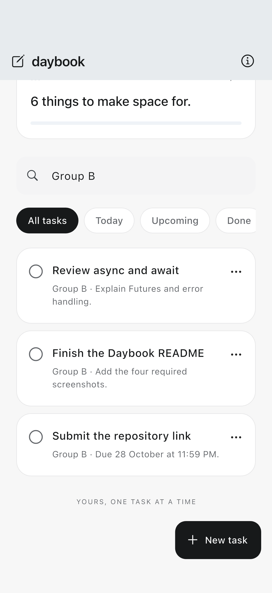
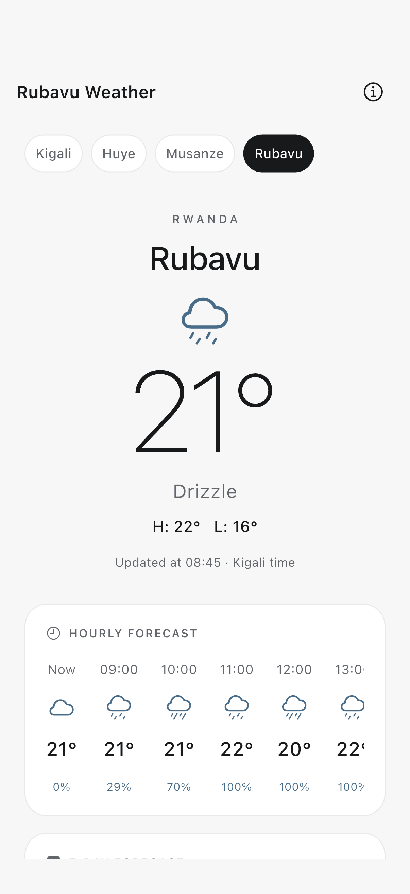
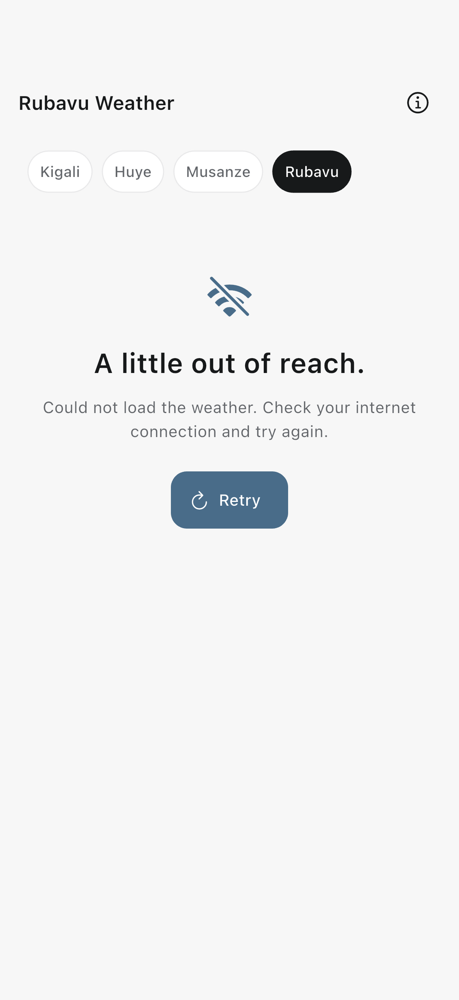

# Daybook

A personal task notebook for planning work, keeping notes, and checking the weather before heading out. Tasks are saved locally in SQLite, so additions, edits, completion changes, deletions, and undo survive closing the app. Live weather comes from the Open-Meteo Forecast API; SharedPreferences remembers the selected city.

| Submission detail | Value |
| --- | --- |
| Student | **Pacifique Bakundukize** |
| Student ID | **26798** |
| Class group | **Group B — Tuesday group** |
| Assignment | Mobile Programming · Session 5 · Data from the Internet |
| Mini project | **Daybook** |
| Repository | [pac-cee/daybook](https://github.com/pac-cee/daybook) |
| Submission deadline | **Wednesday, 28 October 2026, 11:59 PM** |

## Screenshots

Captured from Daybook on an **iPhone 17 Pro simulator**. The persistence test runs in two separate application processes and compares each saved task's ID and every field. Weather comes from a successful live Open-Meteo request.

| Before closing | After running again |
| --- | --- |
|  |  |

The three tasks were added through the task form. The shared **Group B** notes filter and scroll position were reapplied after relaunch for a like-for-like comparison; the task records were restored from SQLite, not recreated.

| Live API data | No internet: error and Retry |
| --- | --- |
|  |  |

**Offline test method:** iOS Simulator shares its host's connection. The automated test injects a `SocketException` at the request boundary for an uncached city while using the production controller and screen. This is a controlled offline simulation, not a claim that Airplane Mode was enabled. Retry then succeeds against the real API after the failure is removed.

## Features

- Add tasks with a title, longer notes, priority and optional due date.
- Edit existing tasks and mark them complete or incomplete.
- Search both task titles and notes.
- View all open tasks, tasks due today (including overdue), upcoming tasks, and completed tasks.
- Delete tasks and undo the most recent deletion, including after relaunching.
- Track completed versus total tasks.
- See live weather for Kigali, Huye, Musanze and Rubavu.
- Open hourly and seven-day forecasts, refresh, retry failed requests, or view a clearly marked saved forecast offline.
- Use a restrained white/black interface with a muted blue accent and Cupertino icons.

## Why weather belongs in Daybook

Daybook supports daily planning. Weather is useful context for errands, walks, travel and outdoor activities. The weather card is optional information; tasks remain usable offline and never depend on a successful forecast request. Daybook does not claim to reschedule tasks automatically based on weather.

The assignment asks each mini project to show one live API feature with loading, error and data states, and explicitly permits Open-Meteo weather for any project.

## Run the application

Prerequisites: Flutter compatible with Dart `^3.13.2`, Xcode and an iOS simulator for iOS, or the Android toolchain and an emulator/device for Android.

This repository contains both `daybook/` and the sibling `kigali_weather/` package. Keep them together: Daybook imports the shared task/weather implementation with a local package dependency.

```sh
# From the repository root:
cd daybook
flutter pub get
flutter run
```

To build and install both applications on an already booted iOS simulator:

```sh
./scripts/install_both.sh
```

No API key, login, or location permission is required. Daybook uses the fixed city coordinates supplied in the lesson. Its iOS bundle identifier is `rw.sessionfive.daybook`.

## Project organization

```text
repository/
├── README.md                       submission landing page
├── screenshots/                    required images for the root README
├── daybook/
│   ├── lib/main.dart               Daybook application entry point
│   ├── integration_test/           native screenshot and restart evidence
│   ├── screenshots/                the four required PNG images
│   ├── ios/                        native iOS host
│   ├── android/                    native Android host
│   └── pubspec.yaml                dependencies and local package link
├── kigali_weather/
│   ├── lib/task_app.dart           Daybook composition root
│   ├── lib/core/                   shared theme, services and database
│   ├── lib/features/tasks/
│   │   ├── domain/                 Task model and serialization
│   │   ├── data/                   SQLite task repository
│   │   └── presentation/           controller, task screen and editor
│   ├── lib/features/weather/
│   │   ├── domain/                 city/weather/forecast models
│   │   ├── data/                   HTTP API and SQLite cache
│   │   └── presentation/           loading/error/data state and widgets
│   ├── test/                       unit, HTTP, persistence and state tests
│   ├── warmup.dart                 Future/async/await exercise
│   └── check_weather.dart          command-line live weather check
├── docs/                           research, architecture and assignment notes
└── scripts/                        verification and installation commands
```

The shared implementation avoids duplicating weather logic between the lesson app and Daybook. The two installed applications still have separate identities and separate local databases.

## API integration

**Provider:** [Open-Meteo](https://open-meteo.com/)

**Endpoint:** `GET https://api.open-meteo.com/v1/forecast`

**Documentation:** [Forecast API](https://open-meteo.com/en/docs)

Requests send latitude/longitude, requested current/hourly/daily fields, Celsius, km/h and `Africa/Kigali` as the weather timezone. An API key is not needed for the provider's free noncommercial endpoint; its [usage terms and limits](https://open-meteo.com/en/pricing) apply. Weather data is attributed to Open-Meteo under CC BY 4.0.

The request is asynchronous, checks the HTTP status, times out after 12 seconds and validates decoded data. A failed request shows a retryable error or the selected city's saved forecast. Cached data keeps its original observation date/time and is clearly marked offline. A request counter prevents a slow response for a previously selected city from replacing the current city's screen.

## Persistence and database design

The lesson demonstrates SharedPreferences for small saved values. This project deliberately uses **SQLite for structured records**, with **SharedPreferences for city selection**. It does not claim that task records are stored in SharedPreferences.

| Storage | Purpose |
| --- | --- |
| SQLite `tasks` | ID, title, notes, priority, completion, due date and creation time |
| SQLite `weather_cache` | One serialized forecast per city |
| SQLite `metadata` | One-time sample initialization marker |
| SQLite `task_undo` | Most recently deleted task, available after restart |
| SharedPreferences `city` | Last selected weather city |

Task changes are awaited before the UI reports success. Delete and undo use transactions. Sample tasks are seeded once: deleting every task leaves an empty list rather than restoring unwanted samples. Queries bind parameters instead of building SQL from task text.

Data remains on the device. There are no accounts, cloud synchronization, advertising or analytics. Uninstalling the app can remove its data.

## Session 5 concepts in the code

| Concept | Implementation |
| --- | --- |
| `Future`, `async`, `await` | `warmup.dart`; `WeatherApi.fetch`; asynchronous repositories |
| HTTP request and status code | `features/weather/data/weather_api.dart` |
| `jsonDecode`, models, `fromJson`/`toJson` | `features/weather/domain/weather.dart`; `features/tasks/domain/task.dart` |
| Loading/error/data and `try`/`catch` | `features/weather/presentation/weather_controller.dart` |
| Refresh and Retry | `features/weather/presentation/weather_screen.dart` |
| Remember selected city | `WeatherController.start` and `select` |
| Save and restore local records | `features/tasks/data/task_repository.dart` |
| Atomic delete and persistent undo | `TaskRepository.delete` and `undoDelete` |
| State separate from widgets | ChangeNotifier controllers and feature folders |

Paths in this table are relative to `kigali_weather/lib/`, except `warmup.dart`, which is in the package root.

## Testing

```sh
# From the repository root:
cd kigali_weather
flutter test
flutter analyze
cd ../daybook
flutter analyze
```

The ordinary Flutter suite covers model parsing, malformed responses, HTTP errors, selected-city races, offline recovery, and SQLite close/reopen persistence. The headless verifier additionally checks forms through pointer taps and renders multiple UI states; its fixture images are separate from the native submission evidence.

For a complete native capture and restoration of the normal app, run `./scripts/capture_submission.sh` from the repository root.

The native evidence test runs twice, with distinct processes, against the installed simulator database:

```sh
cd daybook
flutter test integration_test/submission_test.dart --no-uninstall -d SIMULATOR_UDID \
  --dart-define=SUBMISSION_PHASE=before
flutter test integration_test/submission_test.dart --no-uninstall -d SIMULATOR_UDID \
  --dart-define=SUBMISSION_PHASE=after
```

The test adds only the three specifically named submission tasks, retains existing user tasks, and checks that all saved fields survive the second run. Capture details and final outcomes are recorded in `docs/SUBMISSION.md` at the repository root.

## Submission

This is **Daybook**, the Session 5 mini project for **Pacifique Bakundukize, student ID 26798, Group B**.

The submission PDF requires a public GitHub repository and the Group B form: [Group B submission form](https://forms.gle/w68h6dtKp31bemRj7). Deadline: **28 October 2026 at 11:59 PM**. The PDF's deadline supersedes the earlier time in the HTML guide.

The slides' future capstone announcement is separate from this submission. No cloud backend, authentication system, Figma deliverable, or published video is claimed here.
